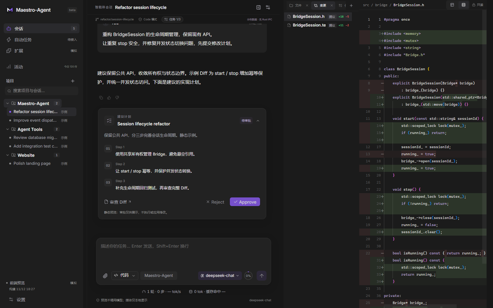
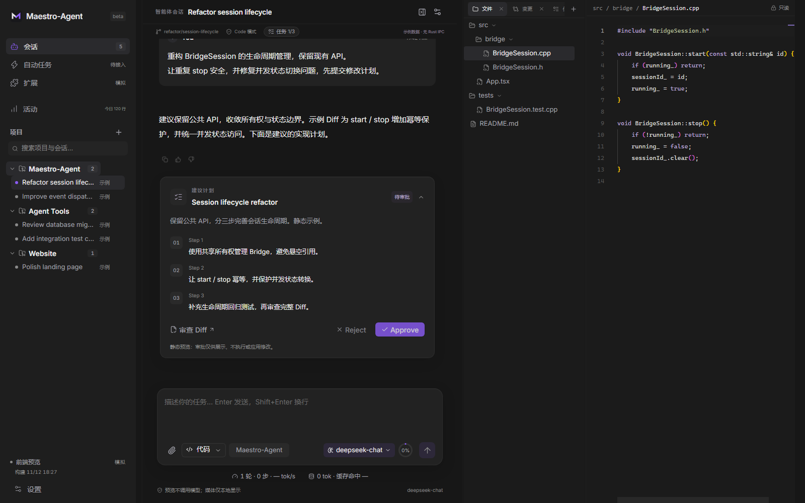
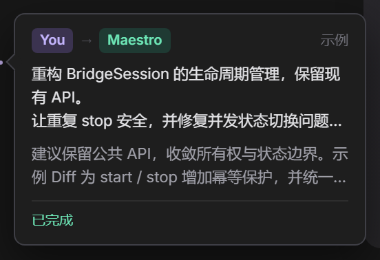

# Maestro-Agent

**A Rust-native AI desktop workbench — streaming conversations, persistent sessions, and read-only workspace exploration.**

Maestro-Agent 是基于 **Tauri 2 + React 19 + Rust** 的早期 AI 桌面工作台。它将对话、会话管理和代码审查组织在可调整的三栏界面中，使用系统 WebView，不引入 Electron。

> **开发阶段：Phase 3。**真实模型聊天、工具调用循环（Skill/MCP）、只读文件浏览，以及经批准的写入/命令执行已经实现。部分界面用于明确标注的 Mock 演示。

## 界面预览



<details>
<summary>查看 Explorer / 代码预览</summary>



</details>

<details>
<summary>查看轮次预览卡片</summary>



</details>

以上为项目自带 Mock 数据的浏览器截图，展示布局与交互，不代表真实工作区、模型执行或原生桌面验收结果。

## 功能状态

| 功能 | 当前状态 |
| --- | --- |
| Provider 聊天 | `LlmProvider` 适配器统一 SSE（OpenAI 兼容/Anthropic），reasoning/content 在 Rust 侧分类后经 `kernel-event` 单通道下发；OpenCode Go/Zen 端点自动附加稳定 `x-opencode-session` 与自有 User-Agent |
| 执行时间线 | reasoning、tool_call 与正文都进入同一条时间线；连续思考/工具折叠为「已工作 X 秒」执行阶段，正文按真实事件位置穿插，不再固定堆在底部 |
| 工具事件行 | 工具/思考行右侧 Chevron 展开详情；执行中亮色 + Loader，完成后整行与图标灰化、hover 恢复；点击文件名打开右侧 Explorer 并加载 Monaco |
| 停止生成 | 前端封存当前段并忽略该轮后续 token；Rust 使用独立 `cancelled_run` 标志 + 250ms 流轮询，取消不排队于命令锁；不显示自定义「停止中」中间态，终态由后端事件驱动 |
| 本地会话 | SQLite 持久化多轮对话、运行结果和内部审计，恢复异常中断记录 |
| 桌面生命周期 | Tauri 单实例、单个活动运行、取消与退出排空 |
| 工作区 Explorer | 显式选择目录，读取真实文件树和 UTF-8 文本，Monaco 只读预览；树结果缓存，`workspace_changed` 防抖刷新，扫描不持锁 |
| Review / 审批 | 提议 Diff 与单次计划决定；计划批准仅记录意图；真实模型的写文件/命令调用会生成工具级审批卡片 |
| IDE 工作台 | 三栏（侧栏 + 对话 + 右侧面板，按需打开），侧栏 280（220-360）可拖拽并持久化；右侧面板为可增删的 文件/变更/任务 Tab（+ 添加、x 关闭），Diff 默认行内/上下；会话搜索、项目分组、Settings、快捷键 |
| 轮次预览 | 悬停左侧刻度显示深色预览卡片：`You → Maestro` 角色、相对时间、问题/回答摘要、状态与最近工具；点击跳转并短暂高亮目标轮次 |
| 上下文指示 | 输入框右侧 Context 圆环：百分比 + Tooltip，80% 变黄、90% 变红 |
| Composer 统计 | Composer 下方居中的两枚统计 Pill（轮/步/tok/s；总 tokens/缓存命中），点击查看输入、缓存读取、未缓存输入、输出明细；缓存命中严格按 provider usage，缺失时显示 — |
| 消息操作 | 最终回答下方 Copy / ThumbsUp / ThumbsDown / 时间戳；点赞点踩为本地 UI 状态，不上报后端 |
| 品牌 / 图标 | 双色 M MaestroLogo；Tauri 桌面图标由 `app-icon.svg` 生成（ico/icns/png/Square/StoreLogo） |
| 国际化 | 默认 zh-CN；英文切换目前覆盖基础导航与设置标签，完整 i18n 仍在后续 |
| Command Center | `Ctrl/Cmd+K` 顶部快速面板：命令 / 会话 / 文件模糊搜索、方向键导航、本地搜索历史 |
| 会话列表 | 单行极简：状态点 + 标题 + 相对时间；轮数/#id/完整标题在 tooltip 与 aria-label；本地置顶与日期分组；置顶仅存 localStorage |
| 计划 / 任务 | 计划卡待审批展开、已结案折叠；`update_plan` 任务步骤实时进入右侧 Tasks Tab，聊天区顶部显示“任务 N/M”胶囊；已完成步骤灰化+删除线 |
| 消息操作 | 用户气泡下方 hover 显示复制/编辑；编辑把该轮 prompt 回填输入框并聚焦，不改写历史 |
| 模型能力 / 会话统计 | 动态思考选项与目录上下文上限，Provider usage/计时；缺失用量明确标为估算 |
| 主题 / 消息 | 实际 Dark/Light/System、Markdown 高亮与复制，本地图片/视频缩略图（不上传） |
| Skills | `~/.maestro/skills/` + 项目 `.maestro/skills/` 双源扫描（项目覆盖全局），SKILL.md frontmatter 解析，新建/本地/GitHub 导入；模型经 `load_skill` 工具加载技能正文 |
| MCP | 最小 stdio JSON-RPC 客户端（`~/.maestro/mcp.json`），启停子进程、`tools/list`/`tools/call`，工具以 `mcp__<server>__<tool>` 注入模型；`trust` 默认 false，只有显式信任的服务才允许 `readOnlyHint` 生效 |
| 工具循环 | `ToolRouter` 统一注册内置/MCP 工具（标准 JSON Schema），`AgentLoop` 执行-续流，全程走模式授权与审计 |
| 滚动 | 流式期间自动贴底；用户上滑暂停、回底恢复；`requestAnimationFrame` + `ResizeObserver` 处理批量工具节点与折叠过渡 |
| Activity | Dashboard 仍为 Mock 演示数据 |

**Workspace writes and commands are real, but gated by mode.** Plan is the backend default and read-only; Code and Confirm suspend write/patch/command tools until the user approves, then execute them for real; Auto executes already-authorized tools directly. Approving a plan only records intent — it never applies a diff by itself. MCP tools honor the active mode and each server's `readOnlyHint` only after the user explicitly trusts that server; `load_skill` is a read-only skill loader. Legacy Execute is retained in historical records only.

## 快速开始

### 1. 获取项目

```powershell
git clone https://github.com/fenggezaici/Maestro-Agent.git
Set-Location Maestro-Agent
```

前端使用 **Node.js 24 + pnpm 12**，版本由 `packageManager` 和 `pnpm-lock.yaml` 固定。

### 2. 只看前端 UI

无需 Rust、WebView2 或 API Key：

```powershell
corepack.cmd enable pnpm
pnpm.cmd install --frozen-lockfile
pnpm.cmd dev:ui
```

自动打开 **http://127.0.0.1:1420/?preview=1**。这是隔离的本地 Mock 预览：可以切换项目、调整布局并创建模拟会话，但不能发送真实聊天或读取磁盘。

如无法启用 pnpm shim，可直接使用 `corepack.cmd pnpm install --frozen-lockfile` 和 `corepack.cmd pnpm dev:ui`。非 PowerShell 环境可使用对应的 `pnpm` / `corepack` 命令。

### 3. 运行 Windows 桌面客户端

另需 Rust MSVC 工具链、Visual Studio C++ Build Tools / Windows SDK，以及 WebView2 Runtime：

```powershell
pnpm.cmd tauri dev
```

进入左下角 **Settings → Models**，填写并保存：

- **Provider / Base URL**：选择 OpenAI、DeepSeek、Anthropic 或 Ollama，独立保存配置；Rust 自动补全兼容端点或 Anthropic `/messages`。
- **API Key**：服务提供的访问密钥；本地 Ollama 可为空，其他 Provider 不会复制已有 Key。
- **Model**：该服务支持的模型名称。

输入消息并发送，或按 **Ctrl/Cmd+Enter**。右侧 **Explorer** 在开发模式下默认浏览当前仓库，也可通过路径栏选择其他本地项目。

更新 Rust 后，先关闭旧窗口、在启动终端按 Ctrl+C，再重新运行 `pnpm.cmd tauri dev`。当前开发与打包流程面向 Windows；其他平台尚未完成验证。

动态思考能力、估算统计、本地附件和 v3 模式迁移的说明见 [核心交互与模型能力](docs/core-interactions.md)。

## 安全与数据边界

> **API Key 明文保存在 WebView localStorage，不是系统凭据库。**仅在信任的本机使用，优先配置 HTTPS；开发窗口和安装版的 origin 不同，需要分别保存配置。

- 配置凭据不会主动写入会话数据库、审计或日志；模型错误文本会脱敏。
- 会话数据库包含用户消息与模型回复，请视为私人数据。位置为 Tauri `app_data_dir()/maestro.sqlite3`。
- 所有 SQLite 操作由 `maestro-sqlite` 专用 OS 线程独占，通过有界 `mpsc` 与异步调用者通信；不会在异步线程直接执行阻塞 SQL。
- Rust 持有模式与运行授权；Plan Mode 拒绝副作用工具和未知名称，但允许应用内部会话/审计落库。
- Workspace reads run separately in `spawn_blocking`, skip `.git`, `node_modules` and `target`, and enforce path, link, scan-budget and file-size limits. The selected root is cloned before scanning, so long scans never hold the state lock; the Explorer caches the last tree and refreshes on debounced `workspace_changed`.
- System prompt tells the model that paths outside the selected workspace cannot be read: it must ask the user to copy/move the file into the workspace instead of probing the sandbox.
- 文件浏览不会自动把内容发送给模型。只读检查不是完整 OS 沙箱；并发恶意文件系统下的残余 TOCTOU 风险见[工作区文档](docs/workspace-filesystem.md)。
- 扩展数据存放于 `~/.maestro/`（`skills/`、`mcp.json`）。MCP 子进程以无 stderr 输出的 stdin/stdout 管道启动，30s 调用超时，应用退出时统一回收；导入与 GitHub 克隆仅接受 HTTPS 地址且经路径校验。

真实聊天上下文由 Rust 从指定会话的已完成记录重建，附加模式提示。前端使用带运行/会话 ID 与序号的 IPC 事件，避免串流和重复追加。

## 技术架构

```text
React 19 + TypeScript + Vite + Tailwind CSS 4
  components (dumb) ← hooks ← zustand stores ← api/ (唯一 invoke/listen 边界)
					  │ Tauri IPC: invoke + 单一 kernel-event 通道
					  ▼
commands/ (仅透传) → services/ (kernel · agent_loop · tool_router · extensions)
	→ adapters/ (llm · mcp · fs · skills · db) → domain/ (纯类型与策略)
```

| 路径 | 职责 |
| --- | --- |
| `src/api/` | 唯一 IPC 边界：types/kernel/sessions/extensions/workspace/dialog/models |
| `src/stores/` | `useKernelStore`、`useWorkspaceStore`（zustand 全局状态与命令） |
| `src/hooks/` | `useAgentStream`（事件订阅/重放/对齐）、`useKernel`、`useWorkspace`、`useExtensions`、`useStickyScroll`（rAF/ResizeObserver 贴底与用户上滑暂停） |
| `src/lib/` | `conversation.ts` 纯函数：reducer、快照重放、reasoning/tool/content 时间线切分、会话拼装 |
| `src/components/` | Dumb 组件（ChatStream、Composer、WorkbenchLayout 自定义 flex 分栏、ContextRing 等），只接 props 不碰 IPC |
| `src/i18n.tsx` | 轻量 I18nProvider / useT，按语言提供统一文案字典 |
| `src/preview/` | 与真实 IPC/凭据隔离的前端预览数据（不调 invoke/listen） |
| `src-tauri/src/commands/` | IPC 接口层，仅参数透传与错误包装 |
| `src-tauri/src/services/` | `kernel`（生命周期/事件/取消）、`agent_loop`（ReAct）、`tool_router`（统一注册/分发）、`extensions` |
| `src-tauri/src/adapters/` | `llm/`（LlmProvider trait + SSE + OpenAI/Anthropic/catalog）、`mcp/`（config/transport/tools）、`fs/`（受限读）、`skills`、`db`（SQLite 线程/迁移） |
| `src-tauri/src/domain/` | 纯类型与策略：session/message/plan/metrics/extension/policy/event/error |
| `src-tauri/capabilities/`, `permissions/` | 本地主窗口的最小命令权限 |

## 测试与构建

```powershell
pnpm.cmd build
pnpm.cmd test
cargo test --workspace
cargo clippy --workspace --all-targets -- -D warnings
```

Rust 测试包含本地 OpenAI 兼容 SSE 服务、取消/错误、会话恢复，以及真实目录与 Windows junction 场景；不需要云端 API Key。前端组件测试与浏览器截图检查不等于完整原生 UI 验收。

生成可重复的 Mock 截图：

```powershell
pnpm.cmd exec playwright install chromium
pnpm.cmd screenshot
```

Chromium 仅是开发测试工具，不进入桌面运行时，也不引入 Electron。原生生命周期检查可使用 `scripts/smoke-desktop.ps1 -NativeOnly`；完整模型 UI 测试需要有效配置及显式 `-AllowModelRequest`，可能产生费用。

Windows 打包：

```powershell
pnpm.cmd tauri build
```

NSIS 输出位于 `target/release/bundle/nsis/`。优先复用系统 WebView2，缺失时下载 bootstrapper，不捆绑完整 Chromium。打包工具缓存位于 `target/.tauri/`。安装包大小和内存占用请以当前版本实测为准；低内存目标尚未完成验收。

## 文档与后续方向

- [真实模型配置、重启与流式协议](docs/llm-streaming.md)
- [工作区文件读取和安全限制](docs/workspace-filesystem.md)
- [IDE UI 控件与预览边界](docs/ide-ui-upgrade.md)
- [UI 设计、Activity 与截图](docs/ui-redesign.md)
- [初始阶段验证记录（历史）](docs/verification.md)

后续重点：明确授权的模型文件上下文、真实计划与差异生成、执行前文件基线核验、细粒度工具审批、原生 MCP/扩展，以及系统凭据保护。附件和自动任务尚未接入后端。

## License

当前仓库尚未指定项目许可证；公开源码不等于授权自由使用、修改或再分发。依赖组件遵循各自许可证。
