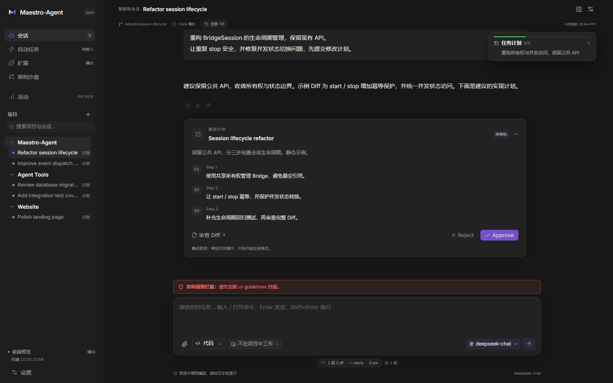
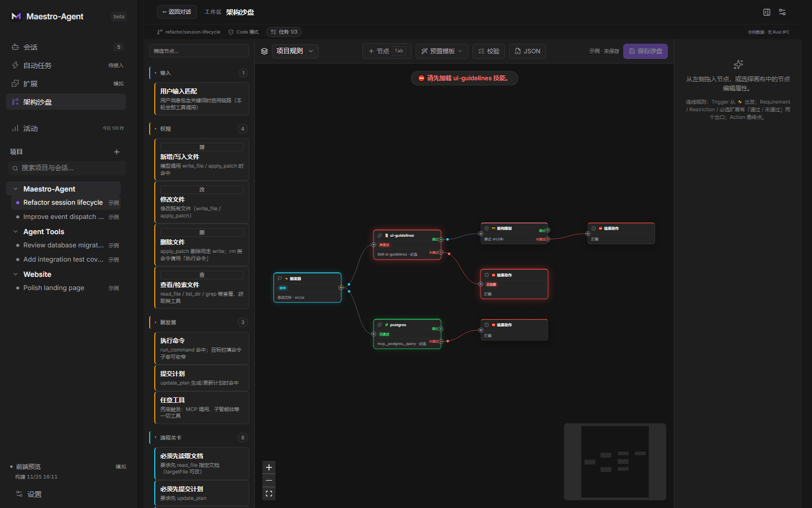
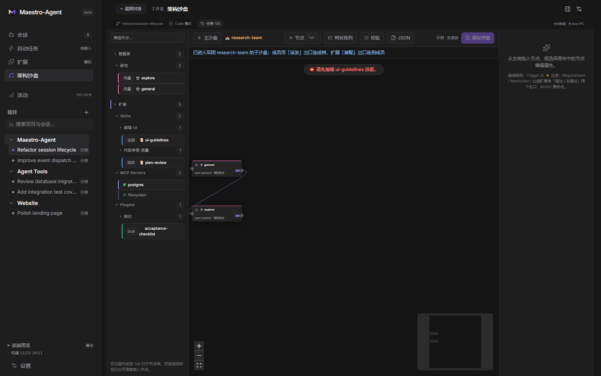
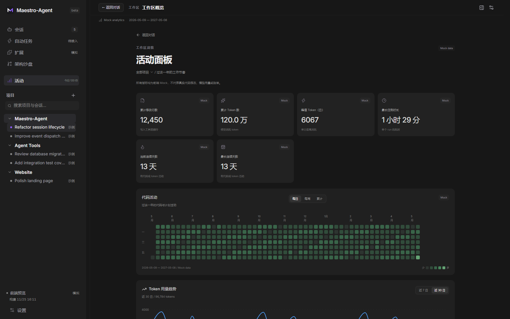

# Maestro-Agent

**A Rust-native AI desktop workbench — Tauri 2 + React 19 + Rust, no Electron.**

对话、工具调用循环、可视化规则编排与代码审查组织在可调整的三栏界面中；所有特权操作由 Rust 模式门禁（Plan/Code/Confirm/Auto）与审批卡片兜底。

> **开发阶段：Phase 3+。** 真实模型聊天、工具循环（Skill/MCP/子智能体）、架构沙盘规则编排、写入/命令审批已实现；部分界面为明确标注的 Mock 演示。

## 界面预览

| 会话工作台（含架构规则拦截） | 架构沙盘（规则编排） |
| --- | --- |
|  |  |
| **军团子沙盘（指挥→成员派发）** | **活动面板（用量与热力图）** |
|  |  |

## 核心能力

| 能力 | 要点 |
| --- | --- |
| **架构沙盘（规则编排）** | React Flow 节点图取代 YAML/静态门禁：Trigger（modify/read/command/plan/any）→ Requirement/Restriction/扩展节点（Skill·MCP·插件，必选项要求真实调用）→ Action（Block/Warn/Remind + 自定义拦截语）。事前拦截、事后验收欠账（还清前其他实质操作被拦、Run 结束被追问）、多路 fail 汇入同一 Action 时逐条列出全部未满足项（merge 语义）。DAG 校验、项目规则优先全局回退、`architecture_trace` 实时节点高亮；提示语留空自动按上游关卡派生、支持 `{call}`/`{target}` 占位符 |
| **子智能体装配** | 扩展节点 →「通过」出口 → 🤖 子智能体节点：声明 `spawn_subagent(type=…)` 时子循环获得的能力。必选绑定在子循环内强制真实调用（Skill 正文预注入 ≠ 已调用），未调完不能收尾，耗尽标注「装配违例」回父模型；可选只注入建议 |
| **智能体军团（子沙盘）** | 🏰 军团节点双击进入内部子沙盘（Houdini subnet）：成员「派发」出口连成「指挥→成员」树，扩展「装配」出口给单个成员授权。`spawn_subagent(type=军团名)` 两态展开——有指挥=指挥嵌套派发（必选成员未派被追问，耗尽标注「编排违例」），无指挥=全员并行合并结果；主图扩展连军团=全员共享授权。预置「示例：调研军团」模板一键生成可跑子图。run 总额度 8、每轮并行 ≤4、成员不可再派 |
| **Provider 聊天** | OpenAI 兼容/Anthropic SSE 统一适配；reasoning/content Rust 侧分类，经单一 `kernel-event` 通道下发（32ms 窗口合并同 key token，前端再按 40ms tick 合并调度——流式高峰期不饿死 invoke 与懒加载） |
| **工具循环与审批** | `ToolRouter` 统一注册内置/MCP 工具；Plan 只读直放 + 白名单只读命令直放（≤4 段手工管道）（非白名单命令/非只读 MCP/写操作硬拒）、Code 对齐 ZCode 自主模式（写直接执行；命令三档分类——只读 argv 免审/未命中危险规则直接执行/命中挂起，嵌套 shell 一律询问）、Confirm 全审、Auto 放行；审批卡片支持 本次/批量/会话/始终 四级；拒绝原因回传模型。循环兜底：tool_calls 三形状回退捕获（delta/message/function_call + flat name）+ 丢碎片计数，空轮（零正文零调用）追问 ×2 后仍空以可见标记收尾不静默、写 `turn_empty` 审计；停滞检测——同名同参调用连续 3 次附警告 / 4–5 拦截不执行 / 6 次硬终止（`doom_abort` 审计，OpenCode DOOM 同口径）。网络工具：`web_fetch`（30s/≤5 重定向/512KB 上限，HTML 提取剔 script/style，输出包不可信边界）与 `web_search`（BYO key Tavily/Brave，凭据复用 DPAPI 存储）属 `NetworkEgress` 第四效应——Plan 物理剥离、Code+Confirm 审批、Auto 放行；审批目标按 URL origin 粒度隔离。`grep_files` 正则语义 + 上下文行（0–5），非法正则报错回传模型可自修正 |
| **Skills / MCP / 命令** | `~/.maestro` + `<workspace>/.maestro` 双源（项目覆盖全局，项目源需显式信任工作区）；`load_skill` 真实加载；MCP stdio + HTTP/SSE 双传输（headers 支持 JSON 或逐行粘贴）、`mcp__server__tool` 注入、trust/readOnlyHint 门禁、每服务 `timeoutMs`、配置即自动启动（`disabled` 除外，单服务失败行内提示；子进程 PATH 去重归一防超长失效；启动恢复逐服务 `extensions_changed` 推送刷新，工作区切换幂等补恢复）；`/` 斜杠命令面板 |
| **子智能体** | `spawn_subagent` 只读研究循环（内置 explore/general + 自定义 `.maestro/agents`，frontmatter 支持 `tool_budget`），独立 trace 面板可下钻/回看，超时/预算/单独停止；管理在「扩展 → 子智能体」（搜索/新建/删除 + 本地目录/GitHub 批量导入角色包，agency-agents-zh 类格式：文件名作 slug、中文名归位描述、强制 `mode: subagent`、同名跳过），编辑/新建深链打开「设置 → 子智能体」单配置器；`~/.maestro/agents.json` 全局默认（模型/轮次/预算/每轮并行/单 run 总额度）——agent 字段留空即继承 |
| **附件与多模态** | 文件选择/剪贴板粘贴/拖拽三通道统一接入（图片/文本，20MiB 上限；文本 ≤64KB 内联），粘贴文本行为不受拦截。图片端到端多模态：超 1MiB 自动 canvas 缩放至 1568px 长边 + webp 重编码、vision 能力门控、Anthropic/OpenAI 双适配 base64 注入；随 run 持久化（重启不丢），历史回放保留最近 2 轮含图消息、更早降级为文本提示 |
| **停止与队列** | 前端乐观终结 + 迟到 token 丢弃；停止期间输入入队，旧 run 终态后自动续跑；取消按 run_id 精确作用域，不误伤新 run |
| **执行时间线** | reasoning/工具/正文按真实事件顺序穿插，连续项折叠为「已工作 X 秒」；running 块 markdown 用 `useDeferredValue`，陈旧帧不重解析 |
| **Activity 仪表盘** | 本地时区日切用量热力图 + 模型维度用量/趋势（Anthropic cache token 计入），项目作用域切换（含「无项目」视图），7/30 天窗口 |
| **会话与项目** | SQLite 持久化（专用 OS 线程 + 有界 mpsc，audit 已建索引）；多项目分组、归档/删除级联、异常中断恢复 |
| **变更卡 / 撤销** | 轮级变更卡（summary 先行、明细含多次写入的累计净差），preview(safe/unsafe) → apply 只回退安全文件 |
| **IDE 工作台** | 三栏可拖拽（rAF + CSS 变量），右侧 文件/变更/任务/子智能体/浏览器/Git 可开合 Tab；`Ctrl/Cmd+K` 命令面板；Explorer Shiki 预览（只读限界 + in-flight 去重）。浏览器 Tab 整幅 iframe 预览 dev server（URL 按项目持久化；元素选取/截图回灌属 P2） |
| **Git 只读感知** | git CLI porcelain v2 机器解析（非 repo 结构化占位、git 缺失可区分；cwd 后端解析无注入面）；面板四来源——未暂存/已暂存/与上游分支对比/commit 历史（refs 徽章+详情+逐文件 diff+分页），diff 懒加载展开、512KB 截断与二进制检测；分支徽章（ahead/behind）进文件面板头部、点击直达；与文件树共用 workspaceTick 节拍自动刷新。写操作（commit/push）明确不做——变更管理走快照制变更卡双轨 |

## 快速开始

前端仅预览（无需 Rust/Key）：

```powershell
corepack.cmd enable pnpm && pnpm.cmd install --frozen-lockfile
pnpm.cmd dev:ui        # → http://127.0.0.1:1420/?preview=1
```

桌面客户端（需 Rust MSVC + VS C++ Build Tools + WebView2）：

```powershell
pnpm.cmd tauri dev     # 启动后 Settings → Models 填 Provider/Key/Model
```

## 安全边界

- API Key 走 Windows DPAPI，不落地 localStorage/数据库
白名单只读命令免审批直放（严格 argv 解析+无 shell，≤4 段手工管道）；`.maestro/` 项目扩展未信任不注入
- Workspace 读取限界（路径/链接/扫描预算），敏感文件 denylist（`.env`/私钥/`.ssh` 等）对模型一律拒绝
- `run_command` 风险分类器为尽力拦截而非安全边界：嵌套 shell/执行器一律询问，未命中规则经平台 shell 直跑

## 架构

```text
React 19 + TS + Vite + Tailwind 4
  components(dumb) ← hooks ← zustand stores ← api/(唯一 IPC 边界)
                    │ invoke + 单 kernel-event 通道
                    ▼
commands/(透传) → services/(kernel·agent_loop·tool_router·extensions)
  → adapters/(llm·mcp·fs·skills·db·web·search·git) → domain/(纯类型与策略)
```

| 路径 | 职责 |
| --- | --- |
| `src/api/` | 唯一 invoke/listen 边界与 wire 类型 |
| `src/stores/` | `useKernelStore`/`useWorkspaceStore` |
| `src/lib/` | `conversation.ts`/`architectureGraph.ts`/`streamMerge.ts` 纯函数 |
| `src/components/` | dumb 组件（ChatStream/Workbench/ArchitectureSandbox…） |
| `src-tauri/src/commands/` | IPC 接口层（含 `debug_assertions` 注入面） |
| `src-tauri/src/services/` | kernel 生命周期、agent_loop ReAct、tool_router、architecture |
| `src-tauri/src/adapters/` | llm/mcp/fs/skills/db（SQLite 线程+迁移 v20）/web/search/git |
| `src-tauri/src/domain/` | 纯类型：session/plan/metrics/architecture/policy/event |

## 测试与构建

```powershell
pnpm.cmd build && pnpm.cmd test            # 前端构建 + vitest
cargo test --workspace                     # Rust 单测（db/architecture/kernel…）
node scripts/e2e-preview.mjs               # ?preview=1 Chromium 冒烟
node scripts/e2e-desktop.mjs               # 真实 exe + WebDriver（含流式洪水回归）
cargo build --features tauri/test          # e2e-desktop 前置
```

本地一键门禁：`corepack pnpm verify:fast` / `verify` / `verify:desktop`。

## 文档

- [核心交互与模型能力](docs/core-interactions.md)
- [流式协议](docs/llm-streaming.md) · [工作区文件边界](docs/workspace-filesystem.md) · [UI 规范](docs/ui-redesign.md)

## Roadmap

- 可写子智能体（独立授权+审批）、Activity 费用估算、完整 i18n、自动任务

## License

当前仓库尚未指定项目许可证；公开源码不等于授权自由使用、修改或再分发。
